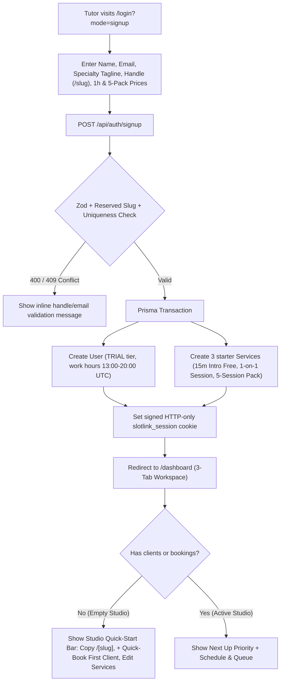
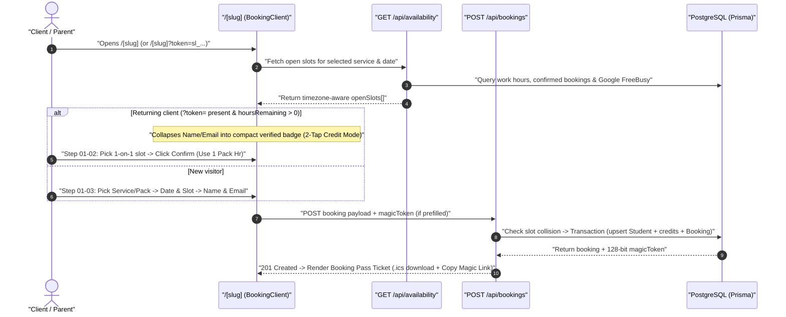
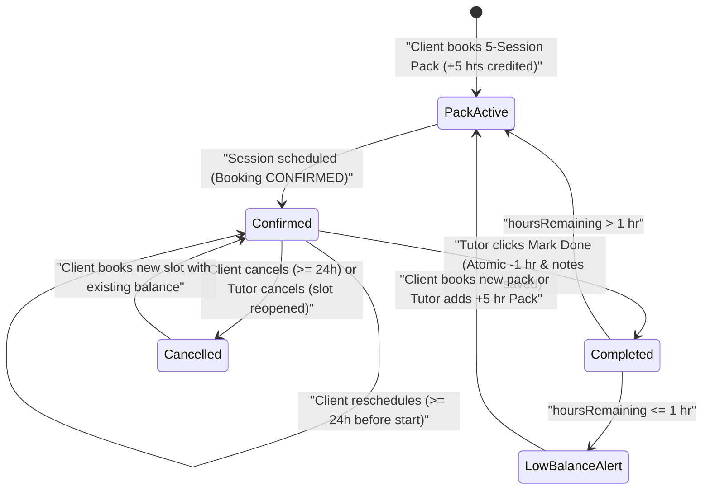
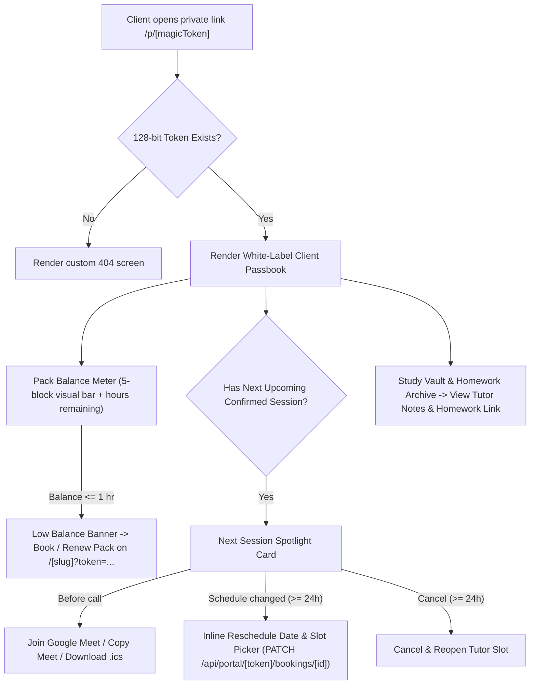

# SlotLink — End-to-End Architecture & User Flow Diagrams

> [!NOTE]
> Every route in **SlotLink** is strictly role-isolated into three interfaces backed by one PostgreSQL system of record: **Public SaaS Marketing & Onboarding** (`/`, `/login`), **White-Label Client Surfaces** (`/[slug]`, `/p/[token]`, `/notes/[slug]`), and the **Educator Studio Workspace** (`/dashboard`).

---

## 1. End-to-End System & Role Isolation Map

```mermaid
flowchart LR
  Visitor["New Educator (Visitor)"] -->|"Explores pricing & sample link"| Landing["Landing Page (/)"]
  Visitor -->|"Clicks Create Studio"| Signup["Create Studio (/login?mode=signup)"]
  Signup -->|"POST /api/auth/signup"| AuthTx["Prisma Transaction (User + 3 Services)"]
  AuthTx -->|"Sets HMAC session cookie"| Dashboard["Pro Studio Dashboard (/dashboard)"]

  Tutor["Returning Educator"] -->|"Email or Google OAuth"| Login["Sign In (/login)"]
  Login --> Dashboard
  Dashboard -->|"Copies personal 1-Link"| Booking["White-Label Booking (/[slug])"]
  Dashboard -->|"Copies private passbook"| Passbook["Client Passbook (/p/[token])"]

  Client["New Client / Parent"] -->|"Opens slotlink.app/[slug]"| Booking
  Booking -->|"GET /api/availability"| FreeBusy["DB Conflicts + Google FreeBusy"]
  Booking -->|"POST /api/bookings"| BookingTx["Prisma Transaction (Upsert Student + Add Pack Hours + Create Booking)"]
  BookingTx -->|"Generates 128-bit magic link"| Passbook

  ReturningClient["Returning Client (?token=...)"] -->|"2-Tap Credit Redemption"| Booking
  Passbook -->|"Opens attached link"| StudySheet["Study Packet (/notes/[slug])"]
```

---

## 2. Flow 1 — 60-Second Tutor Onboarding & Studio Activation

---

## 3. Flow 2 — Public 1-Link Booking & 2-Tap Credit Redemption

---

## 4. Flow 3 — Prepaid Hour-Pack & Session Lifecycle State Machine

---

## 5. Flow 4 — Zero-Login Client Passbook Self-Serve Loop (`/p/[token]`)

---

## 6. UX Friction Audit & Streamlining Summary

| Flow & Route | Friction Found Before | Streamlined Experience Implemented |
| :--- | :--- | :--- |
| **Tutor Studio (`/dashboard`)** | Long vertical stack showing Queue, full Clients table, and Settings/Preview cards mixed together; raw `toLocaleString()` timestamps with seconds; no student pack balance visible on session rows. | Split into **3 focused workspace tabs** (`Schedule & Queue`, `Clients & Pack Balances`, `Services & Settings`), added a **Studio Quick-Start Bar** for new studios, clean formatted timestamps, and live student balance pills (`X hrs left` + `Passbook ↗`) directly inside session cards. |
| **Client Booking (`/[slug]`)** | Returning students opening `/[slug]?token=...` still had to stare at full Name & Email form fields after already being identified; long step transitions without inline selection pills. | Added compact **Returning Client Credit Mode**: Step 03 collapses Name & Email into a single verified identity pill (`Booking as Alex Rivera · Edit`), turning returning credit bookings into a **2-tap flow** while adding inline step summary badges on Steps 01–03. |
| **Client Passbook (`/p/[token]`)** | Next upcoming session sat inside the mixed chronological history list beneath the Study Vault, forcing clients about to join a call to hunt for their Meet link. | Promoted a dedicated **Next Upcoming Session Spotlight** card directly beneath the passbook balance card with immediate **Join Google Meet**, **Reschedule**, **.ics**, and **Cancel** buttons. |
